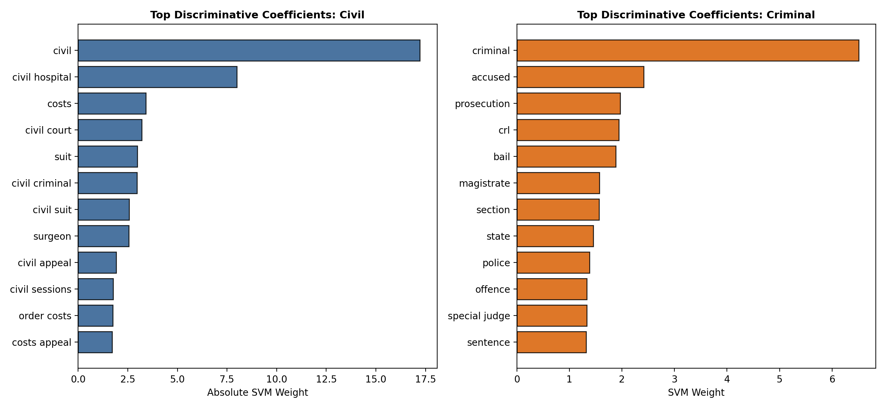
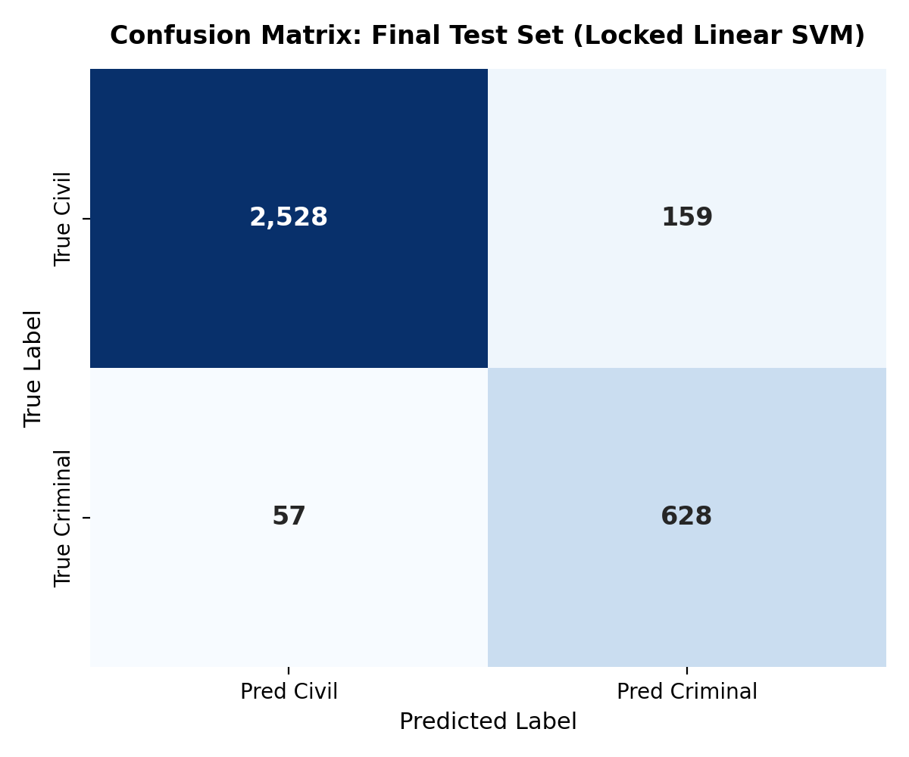

# LegalLens
NLP-Based Classifier for Indian Court Judgments

[](https://www.python.org/downloads/)
[](https://opensource.org/licenses/MIT)
[](https://streamlit.io/)
[](tests/)

---

## 1. Project Overview

**LegalLens** is an applied Natural Language Processing (NLP) system developed as an academic project to perform automated whole-judgment binary classification of Indian court judgments into two fundamental legal categories:

- **Civil**
- **Criminal**

Indian judicial opinions are complex, lengthy, and structurally dense documents that frequently reference cross-domain precedents, statutory enactments, and procedural rules. From an NLP and legal informatics perspective, accurately classifying an entire judgment based purely on judicial text poses distinctive challenges: statutory terms often overlap across jurisdictions (e.g., civil contempt petitions invoking punitive terminology, or criminal corruption proceedings debating civil administrative rules). LegalLens addresses this challenge by engineering a domain-aware textual feature pipeline that extracts discriminative lexical patterns directly from judgment narratives, eliminating reliance on external procedural metadata or post-hoc outcome tags.

### Core Approach & Boundaries
- **Text-Only Input:** Operates strictly on raw Indian court judgment text (Supreme Court and High Court judgments or operative excerpts).
- **Classification Output:** Assigns the primary category (`Civil` vs. `Criminal`) alongside an SVM decision margin and an estimated confidence score.
- **Academic Scope & Non-Goals:** LegalLens is an academic research demonstration in document classification. It is **NOT** legal advice, an automated legal practitioner, a judicial decision-making tool, a sentence-level rhetorical-role tagger, or a case-outcome predictor (such as predicting whether an appeal will be allowed or dismissed).

---

## 2. Key Results

The final locked classifier demonstrates strong generalization across unseen judicial opinions, achieving balanced discriminative performance despite substantial class imbalance.

| Metric | Validation Set ($N=3,372$) | Held-Out Test Set ($N=3,372$) |
| :--- | :---: | :---: |
| **Accuracy** | 94.16% | **93.59%** |
| **Macro-F1** | 0.9148 | **0.9061** |
| **Weighted-F1** | 0.9431 | **0.9375** |
| **Civil Precision** | 98.36% | **97.79%** |
| **Civil Recall** | 94.27% | **94.08%** |
| **Civil F1-Score** | 0.9626 | **0.9590** |
| **Criminal Precision** | 80.65% | **79.80%** |
| **Criminal Recall (Minority Class)** | 93.72% | **91.68%** |
| **Criminal F1-Score** | 0.8670 | **0.8533** |

*Macro-F1 remained above 0.90 on the unseen test set.*

---

## 3. Dataset & Data Preparation

LegalLens was developed using the **Jud-IPL** corpus (*CloLex: Exploring Closed Lexicals for LegalTech*, Jain et al., 2024, CC0 Public Domain). An empirical audit of the raw dataset (`case_files_total.csv`, 838.44 MB) identified critical nuances that guided the preprocessing policy:

- **Raw Dimensions:** 53,446 total raw rows (in contrast to the 42,342 cases reported in initial dataset summaries).
- **Missing & Empty Records:** 9,834 unannotated rows (encoded as `NaN` rather than explicit strings) and 2,236 rows with null or whitespace-only judgment text in the labeled subset were excluded.
- **Duplicate & Conflicting Records:** 7,651 duplicate judgment instances were identified; 2 clusters (6 rows) exhibited conflicting class labels and were purged entirely to preserve ground-truth integrity.
- **Export Truncation Ceiling:** Raw records exhibited an exact 32,765-character cap ($2^{15}-1$), reflecting database export limits. Post-split audit confirmed that no validation cases were identified as truncated under the 32,765-character criterion, so truncation could not be evaluated as a source of validation errors.
- **Final Clean Corpus:** 33,717 unique, verified judgments comprising 26,867 Civil (79.68%) and 6,850 Criminal (20.32%) cases, establishing a 3.92:1 class imbalance ratio.

```
Raw CSV Records (53,446)
       ↓ Drop unannotated/NaN rows (-9,834)
Labeled Cases (43,612)
       ↓ Drop empty judgment texts (-2,236)
Non-Empty Valid Cases (41,376)
       ↓ Purge conflicting-label duplicate clusters (-6)
Consistent Records (41,370)
       ↓ Exact SHA-256 deduplication (-7,653 copies)
Final Cleaned Corpus (33,717 unique judgments)
```

### Partitioning & Leakage Prevention
The corpus was split using an 80/10/10 stratified split (`random_state=42`):
- **Training Set:** 26,973 judgments (21,493 Civil / 5,480 Criminal)
- **Validation Set:** 3,372 judgments (2,687 Civil / 685 Criminal)
- **Test Set:** 3,372 judgments (2,687 Civil / 685 Criminal) — permanently frozen in [`data/processed/frozen_test_ids.json`](data/processed/frozen_test_ids.json)

Pairwise intersection audits confirmed **zero text-hash and zero ID overlap** across train, validation, and test partitions.

> [!NOTE]
> In accordance with repository size best practices, raw (838 MB) and processed data partitions are intentionally excluded from version control via `.gitignore`. Complete audit and cleaning documentation is available in [`docs/milestone_1_dataset_audit.md`](docs/milestone_1_dataset_audit.md) and [`docs/milestone_3_cleaning_and_split_report.md`](docs/milestone_3_cleaning_and_split_report.md).

---

## 4. NLP & Model Pipeline

The modeling pipeline emphasizes domain-aware text representations and linear boundary optimization:

1. **Text Normalization:** Lowercases text and normalizes irregular whitespace and line breaks while preserving statutory section notations, article references, and legal punctuation.
2. **Stopword Handling with Preserved Negations:** Standard English stopwords are filtered, but important legal/semantic negations (`not`, `no`, `nor`, `neither`, `never`, `without`, `against`) are retained to preserve critical culpability context.
3. **TF-IDF Feature Representation:**
   - **N-Gram Range:** Unigrams and bigrams `(1, 2)` to capture compound legal terms (e.g., `writ petition`, `penal code`, `special judge`, `bail application`).
   - **Vocabulary Capacity:** 40,000 maximum features.
   - **Sublinear Term Frequency:** `sublinear_tf=True` (applies $1 + \log(\text{tf})$) to dampen term frequency saturation in lengthy judgments.
   - **Cutoffs:** `min_df=3` (filters OCR typos and rare hapax legomena), `max_df=0.90` (removes universal court boilerplate).
4. **Classification Algorithm:**
   - **Model:** Linear Support Vector Machine (`LinearSVC`).
   - **Regularization:** $C = 1.0$, `loss='squared_hinge'`, `dual='auto'`.
   - **Class Weighting:** Balanced class weighting (`class_weight='balanced'`) was selected because it improved minority-class handling, ensuring high Criminal recall without compromising Civil precision.

The model was fitted strictly on the training partition ($N=26,973$) before any validation or hold-out test evaluation.

---

## 5. Model Evaluation

### Validation Comparison
Baseline and linear architectures were evaluated on the validation set ($N=3,372$):

| Architecture | Class Weighting | Macro-F1 | Criminal Recall | Criminal Precision | Civil Recall | Accuracy |
| :--- | :---: | :---: | :---: | :---: | :---: | :---: |
| **Linear SVM (40k feats, C=1.0)** | **Balanced** | **0.9148** | **93.72%** | **80.65%** | **94.27%** | **94.16%** |
| Linear SVM (30k feats, C=1.0) | Balanced | 0.9107 | 93.43% | 79.80% | 93.97% | 93.86% |
| Linear SVM (30k feats, C=1.0) | Default | 0.9100 | 88.47% | 83.24% | 95.46% | 94.04% |
| Logistic Regression (30k feats) | Balanced | 0.8886 | 94.31% | 73.91% | 91.51% | 92.08% |
| Logistic Regression (30k feats) | Default | 0.8895 | 85.26% | 80.00% | 94.57% | 92.67% |
| Majority Class Baseline | Most Frequent | 0.4435 | 0.00% | 0.00% | 100.00% | 79.69% |

Inspection of model weights highlights domain-aligned discriminative terminology:



### Final Hold-Out Test Evaluation
The locked configuration was evaluated once on the frozen test partition ($N=3,372$):

```
                          PREDICTED CIVIL       PREDICTED CRIMINAL       TOTAL
ACTUAL CIVIL                   2,528                    159              2,687
ACTUAL CRIMINAL                   57                    628                685
TOTAL                          2,585                    787              3,372
```



### Validation vs. Test Generalization
Comparing validation and hold-out test performance reveals stable behavior across independent samples:
- **Macro-F1:** 0.9148 (Validation) $\to$ 0.9061 (Test) (Delta: -0.0087)
- **Accuracy:** 94.16% (Validation) $\to$ 93.59% (Test) (Delta: -0.57%)
- **Criminal Recall:** 93.72% (Validation) $\to$ 91.68% (Test) (Delta: -2.04%)
- **Civil Recall:** 94.27% (Validation) $\to$ 94.08% (Test) (Delta: -0.19%)

*The small validation-to-test performance drop indicates good generalization and no evidence of substantial overfitting.* Complete test evaluation details are available in [`docs/final_test_evaluation_report.md`](docs/final_test_evaluation_report.md).

---

## 6. Prediction Pipeline

The unified prediction pipeline is implemented in `src/predict.py`:

```
Judgment Text → Normalization → TF-IDF (40k feats) → LinearSVC → Decision Margin → Structured Output
```

### Programmatic Usage

```python
from src.predict import predict_judgment

judgment_text = """
This criminal appeal is directed against the judgment and order of conviction 
passed by the learned Sessions Judge under Section 302 of the Indian Penal Code. 
The appellant was sentenced to rigorous imprisonment for life. Bail was rejected.
"""

result = predict_judgment(judgment_text)
print(result)
```

**Output Structure:**
```json
{
  "predicted_class": "Criminal",
  "category": "criminal",
  "decision_score": 1.7098,
  "confidence_prob": 0.8468,
  "probability_criminal": 0.8468,
  "probability_civil": 0.1532,
  "word_count": 42,
  "char_count": 274,
  "is_valid": true,
  "status": "success"
}
```

> [!NOTE]
> **Technical Caveat on Estimated Confidence:**  
> `LinearSVC` optimizes a geometric margin under squared hinge loss rather than cross-entropy loss, producing an uncalibrated decision score. The application calculates an **Estimated Confidence** value via a standard sigmoid transformation ($1 / (1 + e^{-\text{margin}})$). This value serves as a heuristic confidence indicator and is **not a formally calibrated probability**.

---

## 7. Streamlit Application

LegalLens includes an interactive, accessible Streamlit web application (`app/streamlit_app.py`) for classifying court judgments and inspecting model reasoning:

1. **Academic Data Architecture Banner:** Displays the verified 33,717 judgment corpus breakdown (Cleaned Data: 33,717 | Trained Data: 26,973 | Tested Data: 3,372 Frozen | Demo Data: 3,372).
2. **Indian Court Judgments Library:** Sidebar featuring a point-wise list of 10 authentic judgments (5 Criminal, 5 Civil) with a one-click dynamic refresh sampling from the demo pool.
3. **Primary Text Classifier:** Accepts raw text or loaded demo judgments, outputting predicted class, decision margin, estimated confidence, and word/character diagnostics.
4. **NLP Explainability Suite:**
   - **Salient Legal N-Grams:** Visual breakdown of n-gram feature attributions ($x_j \cdot w_j$).
   - **Statutory Entity Detection:** Automatically extracts cited IPC, CrPC, CPC, and statutory Act sections.
   - **Stylometry & Vocabulary Match:** Computes document Type-Token Ratio (TTR), average sentence length, and overlap with the 40,000-term model vocabulary.

---

## 8. Repository Structure

```
LegalLens/
├── app/                 # Streamlit web application, nlp utilities, and CSS styles
├── data/                # Dataset directory (raw/processed data git-ignored; frozen IDs tracked)
├── docs/                # Milestone audit, EDA, benchmark, and test reports
├── models/              # Final trained pipeline artifact (whitelisted for deployment)
├── notebooks/           # Exploratory data analysis Jupyter notebook
├── outputs/             # Generated figures, confusion matrices, and metrics logs
├── src/                 # Preprocessing, feature extraction, training, and prediction modules
├── tests/               # Automated unit tests across pipeline (28 tests)
├── .gitignore           # Git ignore configuration
├── README.md            # Technical documentation
└── requirements.txt     # Python runtime dependencies
```

The `.gitignore` configuration excludes large raw datasets (`case_files_total.csv`, 838 MB), intermediate files, and temporary caches, while explicitly whitelisting the final trained pipeline artifact (`models/final_linear_svm_pipeline.joblib`, 2.05 MB) so that cloud environments can instantiate the model directly.

---

## 9. Development Milestones

The project was executed through an incremental milestone progression:

- **M0 Scaffolding:** Project structure initialization, virtual environment configuration, and repository setup.
- **M1 Dataset Audit:** Empirical inspection of the Jud-IPL corpus, discovering true row counts and export length limits.
- **M2 Exploratory Data Analysis:** Duplicate cluster diagnostics, token distributions, and label consistency audits.
- **M3 Data Cleaning & Splitting:** Deduplication to 33,717 unique cases, 80/10/10 stratified split, and freezing of test IDs.
- **M4 Baseline Model Experiments:** Benchmarking Majority Baseline, Logistic Regression, and Linear SVM models.
- **M5 Error Analysis & Tuning:** Systematic failure mode analysis and expanding TF-IDF feature space to 40,000 terms.
- **M6 Prediction Pipeline:** Reusable inference interface in `src/predict.py` with comprehensive unit tests.
- **Final Hold-Out Evaluation:** Single unbiased test evaluation on 3,372 frozen test cases (Macro-F1: 0.9061, Accuracy: 93.59%).
- **M7 Streamlit Demo & Deployment Readiness:** Interactive web demonstration and automated test verification.

---

## 10. License & Academic Attribution

This project is licensed under the **MIT License**.

If you use or reference the Jud-IPL dataset in academic work, please cite the original authors:

```bibtex
@inproceedings{jain2024clolex,
  title={CloLex: Exploring Closed Lexicals for LegalTech},
  author={Jain, Bhavya and Harde, Shweta and Jain, Aditya},
  booktitle={Proceedings of the International Conference on Natural Language Processing},
  year={2024},
  publisher={Springer}
}
```
